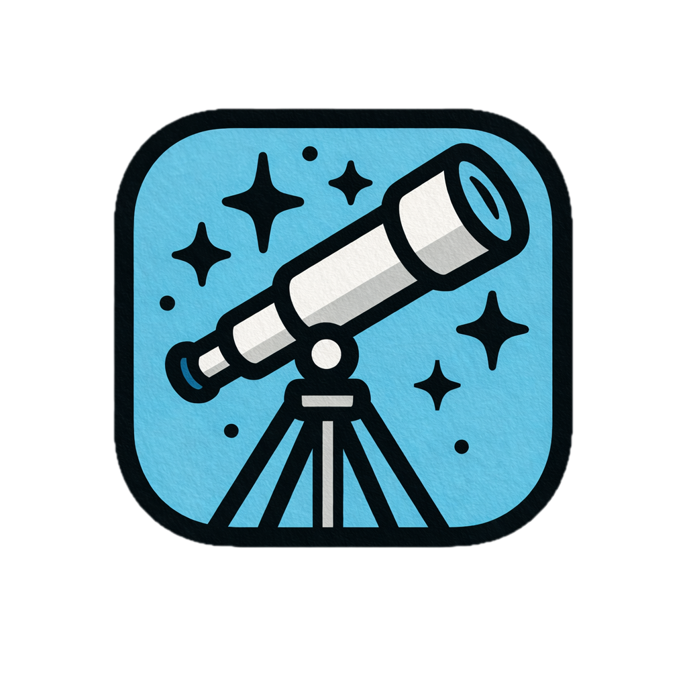

# GitGazer

   

GitGazer is a monitoring and notification system for GitHub workflows, built on AWS serverless architecture. It provides real-time workflow status updates, a dashboard for monitoring across repositories, and customizable notification rules for workflow failures.

**Demo**: <https://app.gitgazer.com/> · **Docs**: <https://docs.gitgazer.com/>

## Features

- **Real-time Dashboard** — monitor GitHub workflow status across repositories with live updates via WebSocket
- **Smart Notifications** — configure Slack alert rules with filters for repositories, branches, workflows, and topics
- **GitHub Integration** — connect via the GitHub App (recommended) or manual webhooks
- **Role-based Access** — owner, admin, member, and viewer roles per integration
- **AI Assistant Access (MCP)** — query your workflow data from VS Code, Claude, or any MCP client through a read-only, OAuth-secured Model Context Protocol server
- **Serverless Architecture** — AWS Lambda (the API runs as a Lambda Web Function behind CloudFront), API Gateway WebSocket, Aurora PostgreSQL, SQS, and CloudFront

## Documentation

Full documentation is available at **<https://docs.gitgazer.com/>** (source in `apps/docs/`).

### User Guide

- [Getting Started](https://docs.gitgazer.com/user-guide/getting-started) — sign in and navigate the app
- [Setting Up Integrations](https://docs.gitgazer.com/user-guide/integrations) — connect GitHub via App or webhooks
- [Monitoring Workflows](https://docs.gitgazer.com/user-guide/workflows) — dashboard, filtering, saved views
- [Configuring Notifications](https://docs.gitgazer.com/user-guide/notifications) — Slack alert rules
- [Slack App](https://docs.gitgazer.com/user-guide/slack-app) — send alerts to Slack channels and mention the person behind a failed job
- [Managing Team Members](https://docs.gitgazer.com/user-guide/team-management) — roles, invitations, org sync
- [Querying Data with AI Assistants](https://docs.gitgazer.com/user-guide/ai-assistants) — connect VS Code or Claude via MCP to query your data

### Technical Documentation

- [Architecture Overview](https://docs.gitgazer.com/technical/architecture-overview) — system design and technology choices
- [Authentication & Authorization](https://docs.gitgazer.com/technical/authentication) — OAuth flow, RBAC, middleware chain
- [Webhook Pipeline](https://docs.gitgazer.com/technical/webhook-pipeline) — ingress, SQS processing, event handling
- [Backfill Pipeline](https://docs.gitgazer.com/technical/backfill-pipeline) — serverless import of historical GitHub data
- [Roles & Permissions](https://docs.gitgazer.com/technical/roles-and-permissions) — integration roles and database-enforced tenant isolation
- [MCP Server](https://docs.gitgazer.com/technical/mcp-server) — read-only SQL access for AI assistants over OAuth 2.1, with tenant isolation
- [Local Development Guide](https://docs.gitgazer.com/technical/local-development) — dev setup, environment config, database access

### CI/CD

GitHub Actions handles automated deployments. The `CI/CD` workflow runs `pnpm nx affected -t build upload` for the changed projects: Lambda zips go to the Lambda store bucket and go live once the `CI/CD Infra` workflow's Terraform apply points the functions at the new S3 object versions; the web app and docs sync to their S3 buckets (docs also invalidate CloudFront). Infrastructure changes run Terraform.

## Contributing

1. Fork the repository
2. Create a feature branch (`git checkout -b feature/amazing-feature`)
3. Commit your changes (`git commit -m 'Add amazing feature'`)
4. Push to the branch (`git push origin feature/amazing-feature`)
5. Open a Pull Request

## License

MIT — see [LICENSE](LICENSE) for details.
