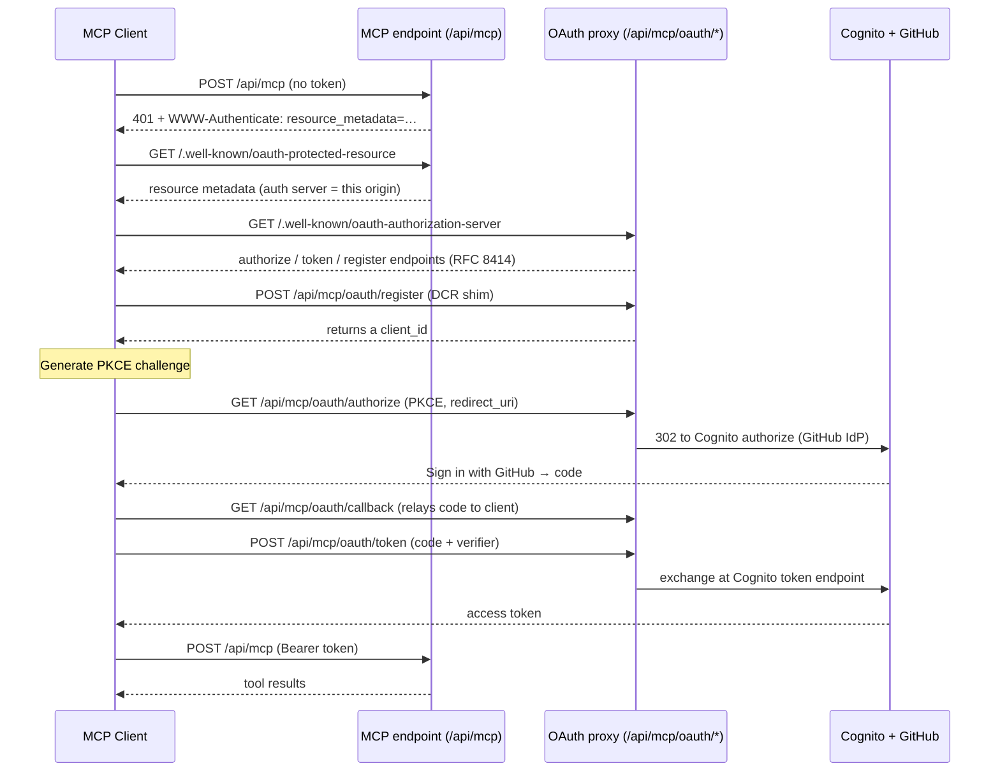

# MCP Server

GitGazer exposes a remote **[Model Context Protocol](https://modelcontextprotocol.io) (MCP)** server so AI assistants — VS Code Copilot, Claude Code, Claude Desktop, Cursor, and any other MCP client — can query a tenant's GitHub Actions data on the user's behalf.

It is **read-only**, authenticated with **OAuth 2.1**, and every query is bounded by the querying user's PostgreSQL role permissions, row-level security, and a usage budget. There is nothing to install: it is served by the `api` Lambda as its `mcp` domain.

For the end-user walkthrough (how to connect a client), see [Querying Data with AI Assistants](../user-guide/ai-assistants.md).

## Endpoint & transport

| Property         | Value                                                   |
| ---------------- | ------------------------------------------------------- |
| Endpoint         | `POST https://<your-gitgazer-domain>/api/mcp`           |
| Transport        | Streamable HTTP (JSON responses, stateless)             |
| Protocol version | `2026-07-28`, and `2025-11-25` for older clients        |
| Auth             | OAuth 2.1 Bearer access token (`Authorization: Bearer`) |

`<your-gitgazer-domain>` is the same host as the GitGazer web app (the CloudFront/custom domain).

The endpoint is served by the official MCP TypeScript SDK (`@modelcontextprotocol/server`), which
owns the wire format. It is **dual-era**, decided per request:

- A request carrying the per-request `_meta` envelope (`io.modelcontextprotocol/protocolVersion`)
  is served as `2026-07-28` by the SDK's `createMcpHandler`, including `server/discover` and the
  `MCP-Protocol-Version`, `Mcp-Method` and `Mcp-Name` header checks.
- Any other request is served as `2025-11-25` by a stateless SDK transport: `initialize` remains
  available but is not required before `tools/list` or `tools/call`, since no session is kept.

Responses are `application/json`. The one exception is a `2026-07-28` `subscriptions/listen`, which
the SDK always answers over SSE; the server advertises no list changes, so that stream closes
immediately with a complete result.

Clients must send `Accept: application/json, text/event-stream`, or the SDK answers `406`. Claude
Code and Claude Desktop already do.

## Authentication

The server is an OAuth 2.1 **Resource Server**, but Cognito on its own does not implement Dynamic Client Registration (RFC 7591), which MCP clients rely on for zero-configuration sign-in. To bridge that, GitGazer ships a small **OAuth authorization-server proxy** in front of Cognito. Clients discover it automatically and connect **without any manual client-ID entry**.

:::note
RFC 7591 Dynamic Client Registration is deprecated as of MCP `2026-07-28` in favour of Client ID
Metadata Documents. The registration shim below still works and remains supported for clients that
rely on it.
:::



Key points:

- **Discovery** follows the MCP spec: RFC 9728 Protected Resource Metadata → RFC 8414 Authorization Server Metadata → registration.
- The proxy is **stateless** — the client's `redirect_uri` and `state` are HMAC-signed into the Cognito `state` parameter, so no server-side session store is needed.
- **PKCE (S256)** is required; the MCP Cognito app client is a public client with no secret.
- **Scope `gitgazer-mcp/read`**: the Cognito resource server `gitgazer-mcp` defines it, and only the MCP app client may request it. The proxy always adds it to the authorize request, even when a client asks for no scope or only `openid`/`email`/`profile`, and it drops any scope it does not advertise.
- The access token must come from the MCP Cognito client and carry `gitgazer-mcp/read`. Access tokens from the web app client are not accepted, so a leaked web token cannot be used against the MCP. Any other token gets `401 invalid_token` with the `WWW-Authenticate` challenge. The token's `sub` is resolved to a GitGazer user, and the user's integrations become the tenant scope for every query.
- Tokens issued before the scope existed lack it and are refused. A refresh keeps the scopes of the original sign-in, so each existing MCP connection has to sign in again once.
- **Redirect allowlist**: the proxy only relays authorization codes to native-app loopback (`127.0.0.1`/`localhost`) and an operator-configurable set of hosted redirect hosts (default `vscode.dev`, `claude.ai`). This is the open-redirect guard — see [Configuration](#configuration).

## Tools

All tools are read-only and run under the `gitgazer_mcp` PostgreSQL role, scoped by row-level security to the caller's integrations.

| Tool             | Input       | Description                                        | Counts against budget |
| ---------------- | ----------- | -------------------------------------------------- | --------------------- |
| `run_sql`        | `{ sql }`   | Run a single read-only `SELECT` / `WITH … SELECT`. | ✅ yes                |
| `list_tables`    | —           | List the tables you may query (schema + name).     | ❌ no                 |
| `describe_table` | `{ table }` | List a table's columns (name, type, nullability).  | ❌ no                 |

`run_sql` returns the columns, rows, a `rowCount`, a `truncated` flag, and the query-time `budget` (see [Limits](#limits-and-budget)).

## Queryable data

Queries run against the `github` schema and the configuration views in `gitgazer`. Because no default `search_path` is set for the role, **tables and views must be schema-qualified** (`github.workflow_runs`, not `workflow_runs`).

| Table                               | Notes                                                          |
| ----------------------------------- | -------------------------------------------------------------- |
| `github.workflow_runs`              | GitHub Actions runs (`conclusion`, `status`, `created_at`, …). |
| `github.workflow_jobs`              | Jobs within runs.                                              |
| `github.workflow_run_pull_requests` | Join table between runs and pull requests.                     |
| `github.pull_requests`              | Pull requests.                                                 |
| `github.pull_request_reviews`       | Pull request reviews.                                          |
| `github.repositories`               | Repositories.                                                  |
| `github.organizations`              | Organizations.                                                 |
| `github.enterprises`                | Enterprises.                                                   |
| `github."user"`                     | GitHub users/actors. `user` is a reserved word — **quote it**. |
| `github.integrations`               | Column-scoped: only `integration_id`, `label`, `created_at`.   |

The configuration lives in tables the MCP cannot read, mostly in `gitgazer`. Each is exposed through a `<table>_view` in the table's own schema. Each view returns the rows and fields the GitGazer API shows the same person. The minimum role is per integration; a column below its role is `NULL` while the row stays visible.

| View                                            | Rows for | Column limits                                                                                                                                                                                                                                                           |
| ----------------------------------------------- | -------- | ----------------------------------------------------------------------------------------------------------------------------------------------------------------------------------------------------------------------------------------------------------------------- |
| `gitgazer.integration_apps_view`                | viewer   | None. Apps connected to an integration.                                                                                                                                                                                                                                 |
| `gitgazer.integration_app_github_settings_view` | viewer   | `secret` (webhook secret): admin.                                                                                                                                                                                                                                       |
| `gitgazer.integration_app_slack_settings_view`  | viewer   | None. The Slack workspace (`team_id`) an app is linked to.                                                                                                                                                                                                              |
| `gitgazer.notification_handles_view`            | viewer   | None. Notification targets.                                                                                                                                                                                                                                             |
| `gitgazer.webhook_handle_details_view`          | viewer   | `url`: admin.                                                                                                                                                                                                                                                           |
| `gitgazer.slack_handle_details_view`            | viewer   | None. Slack channel of a handle.                                                                                                                                                                                                                                        |
| `gitgazer.notification_rules_view`              | viewer   | None.                                                                                                                                                                                                                                                                   |
| `gitgazer.notification_rule_destinations_view`  | viewer   | None. Which handles a rule notifies.                                                                                                                                                                                                                                    |
| `gitgazer.integration_invitations_view`         | member   | `email`, `invite_token`: admin.                                                                                                                                                                                                                                         |
| `gitgazer.event_log_entries_view`               | viewer   | None.                                                                                                                                                                                                                                                                   |
| `github.user_assignments_view`                  | viewer   | None. Members and roles per integration.                                                                                                                                                                                                                                |
| `gitgazer.users_view`                           | viewer   | Users in the caller's integrations, and inviters and invitees of invitations the caller sees (member). `email`: admin, in an integration the user belongs to or has a non-accepted invitation in. `last_active_at`: only for users in one of the caller's integrations. |
| `gitgazer.slack_workspaces_view`                | viewer   | Workspaces linked to the caller's integrations. `installed_by`: only if that user is a member of one of the caller's integrations.                                                                                                                                      |

Views have no cross-table columns, so join them on `integration_id` plus the ids. `gitgazer.users_view` and `gitgazer.slack_workspaces_view` have no `integration_id`; join `gitgazer.users_view` through `github.user_assignments_view`.

Not exposed: the `gitgazer` base tables themselves (the role has `USAGE` on the schema, but `SELECT` only on the views), the Slack bot token, `cognito_id` and `github_id` of users, the `mcp_query_usage` quota table and the signing key.

Example — failing runs per repository over the last week:

```sql
SELECT r.name AS repository, count(*) AS failures
FROM github.workflow_runs wr
JOIN github.repositories r
  ON r.integration_id = wr.integration_id AND r.id = wr.repository_id
WHERE wr.conclusion = 'failure'
  AND wr.created_at > now() - interval '7 days'
GROUP BY r.name
ORDER BY failures DESC
LIMIT 10;
```

Use `list_tables` and `describe_table` to discover the exact columns before writing a query.

## Security model

The raw-SQL path is defended in layers, so a crafted query cannot escape the caller's tenant or read data it was never granted:

1. **OAuth-validated identity** — a valid Cognito access token from the MCP client with the scope `gitgazer-mcp/read` is required; the `sub` resolves to a GitGazer user and their integrations.
2. **Own login and role GRANTs** — queries run on a separate connection that logs in as `gitgazer_mcp` (IAM auth; `NOINHERIT`, not a superuser or table owner), so the session cannot switch to a role that owns the tables or bypasses RLS. Its `GRANT SELECT` list _is_ the allowlist of readable tables and columns. The Data API mode (`DB_CONNECTION_MODE=data-api`) has no separate login, so a session there could switch back to the app login and reach the signing key: `run_sql`, `list_tables` and `describe_table` refuse to run in that mode.
3. **Row-level security on a signed tenant context** — every exposed table carries a tenant policy that reads the caller's integrations from `rls.signed_context`, which the database trusts only with a valid signature:
    - The key lives in the database (`gitgazer_internal.context_key`, generated at migration time and readable only by the migration user, which in AWS is the login the app uses), never in the repository, Terraform or the app config.
    - To rotate the key, run `UPDATE gitgazer_internal.context_key SET key = public.gen_random_bytes(32) WHERE id = 1` as the migration user; MCP queries in flight at that moment fail closed.
    - Before the caller's query, the app reads the MCP session's backend PID and transaction start, has the app login sign the caller's integrations and roles for exactly that session and transaction (`gitgazer_internal.sign_context`, which only the app login may execute), and sets `rls.signed_context` to `<payload>|<signature>`.
    - The key and the sign function live in schema `gitgazer_internal`, where no role but its owner has `USAGE`. `gitgazer_mcp` needs `USAGE` on `gitgazer` for the configuration views, so in `gitgazer` the function's ACL alone would protect it, and a re-created or new `SECURITY DEFINER` function there gets `EXECUTE` for `PUBLIC` by default.
    - `github.signed_context()` verifies the signature once per protected table the query references, not per row (each policy calls it through a sub-select, which Postgres runs as one InitPlan per relation).
    - A missing, malformed, altered or replayed context (copied from another session or transaction) yields no rows, never other tenants' rows, and no error.
4. **Read-only transaction** — `SET TRANSACTION READ ONLY`, and the transaction always ends in `ROLLBACK`; no writes or DDL.
5. **Single-statement guard** — the query is wrapped as a subquery whose byte budget and row cap are bind parameters. Bind parameters make the driver use the extended query protocol, in which Postgres refuses more than one statement, so statement stacking fails at the database. The wrap also gives the query a `SELECT` context, and a query that is not a single `SELECT`/`WITH`, or that contains `;` or a `$1`-style placeholder, is rejected before it runs.
6. **Blocked-function + escape guard** — `set_config` and `pg_settings`, functions that run a SQL string (`*_to_xml*`, `dblink*`, `ts_stat`, `ts_rewrite`), advisory locks (a session lock would outlive the transaction on the pooled connection), `pg_sleep*`, `pg_stat_*`, file, large-object and backend-control functions, nested block comments at the start of the query, and SQL-standard Unicode-escape syntax (`U&"…"`) are rejected. This is a blocklist: a mitigation, not a proof that `set_config` is unreachable.
7. **`set_config` stays executable** — migration `20260721204116_tough_black_bolt` attempts to revoke it, but on Aurora the revoke is a no-op (verified 2026-10-28): `set_config` is granted to `PUBLIC` by an owner the cluster user cannot override. A query that reached `set_config` could write `rls.signed_context`, but not make it valid (layer 3), so layers 5 and 6 are defence in depth.
8. **Resource caps** — a `statement_timeout`, a 2-second `lock_timeout`, a row cap and a result byte budget bound each query. The byte budget is enforced inside the query, so an oversized row never leaves the database.
9. **Per-user budget** — a rolling-window, query-time budget bounds how much `run_sql` execution time a user gets.

### Role-aware access

The signed context carries the caller's role per integration (`<integration-uuid>:<role>` pairs joined by `,`). The SQL helper `github.integration_ids(minimum_role)` returns the verified integrations where the caller holds at least `minimum_role` (`owner`, `admin`, `member`, `viewer`; the default `viewer` means all of them), and none for an unknown role or an invalid context.

To open a table with a role requirement:

- **Row gate**: attach `mcpRolePolicy(minimumRole)` instead of `mcpTenantSeparationPolicy()`. It checks `integration_id = ANY ((SELECT github.integration_ids('<minimumRole>'))::uuid[])`.
- **Column gate**: expose the table through a view that returns admin-only columns only `CASE WHEN integration_id = ANY ((SELECT github.integration_ids('admin'))::uuid[]) THEN … END` (`NULL` otherwise), and grant `gitgazer_mcp` the view, never the base table: `run_sql` takes arbitrary SQL, so any grant on the admin-only column would let the caller read it directly. This rules out `security_invoker = true`, which needs exactly that grant. The view therefore runs as its owner, which owns the base table and is not subject to its RLS, so it must carry its own tenant filter, `integration_id = ANY ((SELECT github.integration_ids())::uuid[])` (or it returns every tenant's rows), and be `security_barrier`, so the planner cannot push a caller's predicate below that filter.
- **Global tables** (no `integration_id`): expose them only through a view scoped to the caller's integrations.

Always call `github.integration_ids` through a sub-select as above, so the signature is verified once per protected table in the query, not once per row.

The configuration views in [Queryable data](#queryable-data) use the column gate. They are defined in `packages/db/src/schema/views.ts`, and the migration grants `gitgazer_mcp` `SELECT` on them and revokes the default reader and writer grants that new `github` and `gitgazer` tables get. It also grants `gitgazer_mcp` `USAGE` on the `gitgazer` schema, and nothing else there. No table uses a row gate yet.

The API reads members and invitations through the same views, so the API and the MCP cannot disagree on who sees what. `GET …/members` reads `github.user_assignments_view` joined to `gitgazer.users_view`, and `GET …/invitations` reads `gitgazer.integration_invitations_view` with its inviter and invitee from `gitgazer.users_view`. Both run in `withRlsTransaction` with `integrationRoles` set to the requested integration and the caller's role in it, which signs that into `rls.signed_context` like the MCP does, and the views null emails and invite tokens below admin in that integration. The API's transactions run on the app login, so it signs on the same connection before switching to `gitgazer_reader`; a second connection could deadlock a full pool. `gitgazer_reader` has `EXECUTE` on `github.integration_ids` and `github.signed_context` and `SELECT` only on the views the API reads; it still cannot sign a context.

The API domains that read through the views are members, invitations and apps. `GET …/apps` reads the apps, their GitHub and Slack settings, the Slack workspace, the notification handles with their webhook and Slack details, and the rule counts from the views, so the webhook secret and the webhook urls are `NULL` below admin; only the Slack member counts read the base tables and `gitgazer.slack_user_links`.

## Limits and budget

| Limit             | Default                | Applies to         |
| ----------------- | ---------------------- | ------------------ |
| Query length      | 10,000 characters      | every `run_sql`    |
| Row cap           | 1000 rows              | every `run_sql`    |
| Result size       | 128 KB                 | every `run_sql`    |
| Statement timeout | 20 seconds             | every `run_sql`    |
| Lock timeout      | 2 seconds              | every `run_sql`    |
| Query budget      | 600 query-seconds/hour | `run_sql` per user |

When more rows exist than the cap, or the rows exceed the result size, the result stops at the last row that fits and `truncated: true` is returned. A row that alone exceeds the result size is dropped and flagged the same way, even when it is the first row and the result is empty.

Each `run_sql` costs the duration of the query. Every `run_sql` result includes the query-time budget (all values in **seconds**):

```json
{
    "budget": {"limit": 600, "consumed": 12.481, "remaining": 587.519, "resetAt": "2026-07-21T15:00:00.000Z"}
}
```

A query is charged whether it succeeds or fails (including hitting the statement timeout), so expensive queries can't run for free. The window is a rolling `windowSeconds` (default 1 hour) that starts on a user's first query and resets once it elapses; exceeding the budget returns a tool error until then. The discovery tools (`list_tables` and `describe_table`) do not consume budget.

## Configuration

Application settings (convict; loaded from Secrets Manager, overridable by env var):

| Setting                    | Env var                          | Default                | Purpose                                                   |
| -------------------------- | -------------------------------- | ---------------------- | --------------------------------------------------------- |
| `mcpServerUrl`             | `MCP_SERVER_URL`                 | derived from domain    | Public MCP URL advertised in OAuth metadata.              |
| `mcpQuota.budgetSeconds`   | `MCP_QUERY_BUDGET_SECONDS`       | `600`                  | Query-time budget per window, per user (in seconds).      |
| `mcpQuota.windowSeconds`   | `MCP_QUERY_QUOTA_WINDOW_SECONDS` | `3600`                 | Budget window length, in seconds.                         |
| `mcpQuota.maxQuerySeconds` | `MCP_QUERY_MAX_SECONDS`          | `20`                   | Max duration of a single `run_sql` (statement timeout).   |
| `mcpAllowedRedirectHosts`  | `MCP_ALLOWED_REDIRECT_HOSTS`     | `vscode.dev,claude.ai` | Hosted OAuth redirect hosts (loopback is always allowed). |

The MCP tools need `DB_CONNECTION_MODE=rds-proxy` (the default), where MCP queries log in as `gitgazer_mcp`. In `data-api` mode they refuse to run with an error.

The app must log in with the same database user that ran the migrations, which owns the signing key and `gitgazer_internal.sign_context`. Otherwise MCP queries fail closed: the caller gets "Tool execution failed" and the cause is logged.

Infrastructure (Terraform):

- `var.mcp_allowed_redirect_hosts` — feeds `mcpAllowedRedirectHosts`; add a client's hosted callback host here to onboard it without a code change.
- `var.enable_rds_proxy` — before enabling the proxy, re-check that `pg_backend_pid()` stays stable within a transaction through it, since the signed context is bound to the backend PID.
- `aws_cognito_user_pool_client.mcp` — the public PKCE client; its ID is plumbed to the Lambda via Secrets Manager and handed to clients by the `/register` endpoint (no manual paste needed).
- `aws_cognito_resource_server.mcp` — the resource server `gitgazer-mcp` with the scope `read`, which only the MCP client is allowed to request.

Database (Drizzle migrations):

- `20260721080153_new_mcp_role` — creates the `gitgazer_mcp` role and per-table tenant policies.
- `20260721080210_new_mcp_role_grants` — grants `SELECT` on the exposed `github` tables (column-scoped for `integrations`); `20260728070749_workable_mordo` adds `pull_request_reviews`.
- `20260721190826_clean_freak` — the `mcp_query_usage` quota table.
- `20260721204116_tough_black_bolt` — best-effort `REVOKE EXECUTE` on `set_config` (a no-op on Aurora).
- `20261028120000_mcp_has_role` — the `github.mcp_has_role` helper, replaced by `github.mcp_integration_ids` in `20261029090000_mcp_signed_context`.
- `20261028130000_mcp_login` — lets `gitgazer_mcp` log in with IAM auth, for its own connection.
- `20261029090000_mcp_signed_context` — the signing key, `gitgazer.mcp_sign_context`, `github.mcp_context()` and `github.mcp_integration_ids()` (renamed in the next migration); the MCP tenant policies now read the signed context.
- `20261029120000_role_aware_views` — renames the signed-context objects without the `mcp_` prefix (`github.integration_ids`, `github.signed_context`, `sign_context`, `context_key`, setting `rls.signed_context`), moves the key and the sign function to the new schema `gitgazer_internal`, adds the 13 configuration views and grants `gitgazer_mcp` `USAGE` on `gitgazer`.

The migration runs by hand right before the deploy, as the migration user. First check that this user owns schemas `gitgazer` and `github` (`SELECT nspname, nspowner::regrole FROM pg_namespace WHERE nspname IN ('gitgazer', 'github')`): a `GRANT USAGE` by a non-owner only warns and grants nothing. Because CI deploys on merge, the migration runs before the merge reaches main. Between the migration and the deploy, the old code calls `gitgazer.mcp_sign_context`, which no longer exists, so every MCP tool call fails with "Tool execution failed" and logs an error until the deploy finishes. It fails closed, and only the MCP is affected.

To roll back, revert both the code and the database: drop the 13 views (`gitgazer.*_view` and `github.user_assignments_view`), run `REVOKE USAGE ON SCHEMA gitgazer FROM gitgazer_mcp`, move `context_key` and `sign_context` back to `gitgazer` (`ALTER … SET SCHEMA gitgazer`) and drop schema `gitgazer_internal`, rename the table, its primary key and the three functions back, restore the old bodies from `20261029090000_mcp_signed_context/migration.sql` with `CREATE OR REPLACE` (dropping the functions would fail on the policies that use them, or reset their grants), and delete the migration's row from the drizzle migrations table.

## Related

- [Querying Data with AI Assistants](../user-guide/ai-assistants.md) — connect a client and start asking questions.
- [Authentication & Authorization](./authentication.md) — the underlying Cognito + GitHub OAuth model.
- [Roles & Permissions](./roles-and-permissions.md) — integration roles, the database roles and their grants.
