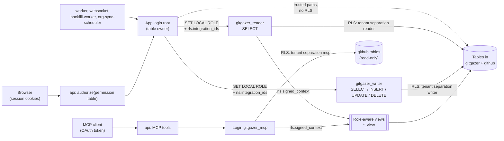
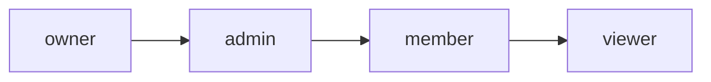
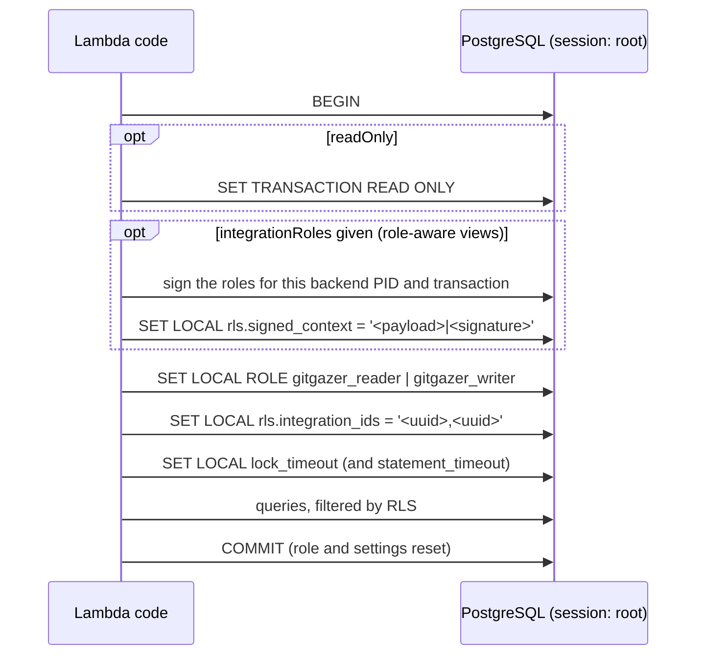

# Roles & Permissions

GitGazer has two layers of roles:

- **Integration roles** (`owner`, `admin`, `member`, `viewer`) belong to a person in one integration. The API checks them before it runs an operation.
- **Database roles** (`gitgazer_reader`, `gitgazer_writer`, `gitgazer_mcp`) belong to a database session. PostgreSQL uses them to decide which tables a query may touch and, through row-level security (RLS), which tenant's rows it sees.

The two meet in the database: every request runs with the caller's integrations, and for the role-aware views also with the caller's integration role per integration.



## Integration roles

Each row in `github."user-assignments"` gives one user one role in one integration. The roles form a strict hierarchy, and a higher role can do everything a lower role can:



The ranks live in `ROLE_RANK` (`packages/db/src/types/members.ts`); `hasRole(userRole, requiredRole)` compares them. The API and the web app use the same function.

| Role       | Meant for                                                                    |
| ---------- | ---------------------------------------------------------------------------- |
| **owner**  | Everything, including deleting the integration. The creator starts as owner. |
| **admin**  | Managing the integration: members, invitations, apps, handles, GitHub App.   |
| **member** | Day-to-day use: notification rules, seeing pending invitations.              |
| **viewer** | Read-only: workflows, dashboards, event log, members, apps and their rules.  |

A user gets a role by:

- **Creating an integration** — the creator becomes `owner`.
- **Accepting an invitation** — the role on the invitation (`admin`, `member` or `viewer`; owner invitations are refused).
- **Organization sync** — members of the linked GitHub organization get the integration's org-sync default role (`viewer`, `member` or `admin`).
- **A role change** by an admin or owner.

### Permission matrix

The permission table in `apps/lambdas/api/src/shared/permissions/table.ts` is the source of truth. It maps each route (`'<METHOD> <path>'`) to an operation and each operation to an access level: `public`, `authenticated` or a minimum role. The `authorize` middleware (`apps/lambdas/api/src/shared/middleware/authorization.ts`) runs after `authenticate` and `originCheck`. For a minimum role it reads the path segment at the pattern's `:integrationId` position, loads the caller's roles if needed, and answers `403` if the caller is not a member (`Not a member of this integration`) or ranks too low (`Insufficient permissions`). A route without a table entry also gets `403`. Role-gated decisions and refusals for a missing entry are logged as `authz` entries.

The two Slack callbacks (`slackApp.installCallback`, `slackUser.signInCallback`) are marked `checkedInHandler`: they learn the integration only from the signed `state`, so their handlers call `checkAccess` themselves.

MCP tools use the same table. `registerTool` takes a tool name from it and calls `checkAccess` on every tool call; a refusal comes back as a tool error in the response, not an HTTP status.

Routes without an `integrationId` in the path (apart from the public routes and the two Slack callbacks) are `authenticated`. They act on all the caller's integrations, and RLS limits them to those. A CI test (`table.test.ts`) fails if a route or tool has no entry, or an entry has none.

| Area          | Operation                                              | Endpoint                                                                                                                     | Minimum role                                        |
| ------------- | ------------------------------------------------------ | ---------------------------------------------------------------------------------------------------------------------------- | --------------------------------------------------- |
| Integrations  | List your integrations (with your role)                | `GET /api/integrations`                                                                                                      | any membership                                      |
|               | Create an integration                                  | `POST /api/integrations`                                                                                                     | signed in (becomes owner)                           |
|               | Rename                                                 | `PUT /api/integrations/:integrationId`                                                                                       | admin                                               |
|               | Delete                                                 | `DELETE /api/integrations/:integrationId`                                                                                    | owner                                               |
|               | Rotate the webhook secret                              | `POST /api/integrations/:integrationId/rotate-secret`                                                                        | admin                                               |
|               | Link / unlink a GitHub App installation                | `POST /api/integrations/:integrationId/github-app`, `DELETE …/github-app/:installationId`                                    | admin                                               |
|               | Change the GitHub App webhook events                   | `PATCH /api/integrations/:integrationId/github-app/:installationId/events`                                                   | admin                                               |
|               | Change the org-sync default role                       | `PATCH /api/integrations/:integrationId/org-sync-settings`                                                                   | admin                                               |
| Members       | List members                                           | `GET /api/integrations/:integrationId/members`                                                                               | viewer                                              |
|               | Change a member's role                                 | `PATCH /api/integrations/:integrationId/members/:userId/role`                                                                | admin                                               |
|               | Remove a member                                        | `DELETE /api/integrations/:integrationId/members/:userId`                                                                    | admin                                               |
|               | Leave the integration                                  | `POST /api/integrations/:integrationId/leave`                                                                                | viewer, except owners                               |
| Invitations   | List pending invitations                               | `GET /api/integrations/:integrationId/invitations`                                                                           | member                                              |
|               | Create / resend / revoke an invitation                 | `POST …/invitations`, `POST …/invitations/:invitationId/resend`, `DELETE …/invitations/:invitationId`                        | admin                                               |
|               | Accept an invitation                                   | `POST /api/invitations/accept`                                                                                               | signed in, with the token                           |
| Apps          | List apps, handles and their settings                  | `GET /api/integrations/:integrationId/apps`                                                                                  | viewer                                              |
|               | Add or remove an app                                   | `POST …/apps`, `DELETE …/apps/:appId`                                                                                        | admin                                               |
|               | Install the Slack app, move a workspace, list channels | `GET …/apps/slack/install`, `GET …/apps/slack/move-candidates`, `POST …/apps/slack/move`, `GET …/apps/:appId/slack/channels` | admin                                               |
|               | Create / edit / delete a notification handle           | `POST …/apps/:appId/handles`, `PATCH …/handles/:handleId`, `DELETE …/handles/:handleId`                                      | admin                                               |
| Slack link    | Connect / disconnect your own Slack user               | `GET /api/integrations/:integrationId/slack/connect`, `DELETE …/slack/connection`                                            | viewer (own account only)                           |
| Notifications | List notification rules                                | `GET /api/notifications`                                                                                                     | any membership                                      |
|               | Create / update / delete a notification rule           | `POST /api/integrations/:integrationId/notifications`, `PUT …/notifications/:id`, `DELETE …/notifications/:id`               | member                                              |
| Monitoring    | Workflows, overview, metrics                           | `GET /api/workflows`, `/api/overview`, `/api/metrics/*`                                                                      | any membership                                      |
|               | Event log, mark entries read                           | `GET /api/event-log`, `PATCH /api/event-log/:id/read`, `POST /api/event-log/mark-all-read`                                   | any membership                                      |
| Other         | WebSocket token                                        | `GET /api/auth/ws-token`                                                                                                     | signed in                                           |
|               | MCP tools                                              | `POST /api/mcp`                                                                                                              | any membership; what is visible depends on the role |

"Any membership" means any role in the integration the data belongs to; a user with no integrations gets empty results. The read flag of an event log entry is stored on the entry, so marking it read marks it for everyone in the integration.

### Rules beyond the minimum role

The members controller (`apps/lambdas/api/src/domains/members/members.controller.ts`) adds these checks:

- Nobody can change their own role.
- Only an owner can give someone the `owner` role.
- Only an owner can change the role of an owner or an admin. An admin can change members and viewers, including promoting them to admin.
- Nobody can remove an owner. Only an owner can remove an admin. Nobody can remove themselves; they leave instead.
- An owner cannot leave.
- Invitations carry `admin`, `member` or `viewer`, never `owner`.

The Slack install callback (`/api/slack/oauth/callback`) checks for admin itself, because it has no `integrationId` in the path.

### Several owners and ownership transfer

An integration can have more than one owner: an owner can promote anyone to owner. The API also lets an owner change another owner's role, so a handover is: promote the new owner, the new owner changes the old owner's role, the old owner leaves. The web app does not offer the middle step: its member card has no role menu for owners.

### Data that depends on the role

Below the role in the table, the field is empty (`NULL`) while the rest of the row stays visible. The API and the MCP read these through the same [role-aware views](#role-aware-views), so they agree.

| Data                                                   | Minimum role |
| ------------------------------------------------------ | ------------ |
| Pending invitations                                    | member       |
| Invitation email and invite token                      | admin        |
| Email addresses of members, inviters and invitees      | admin        |
| GitHub App webhook secret (`secret`)                   | admin        |
| Webhook handle URLs                                    | admin        |
| Everything else in the integration (runs, jobs, rules) | viewer       |

### In the web app

The web app hides what the caller's role does not allow, using `hasRole` with the role that `GET /api/integrations` returns for each integration (for example `IntegrationSettings.vue`, `IntegrationMembers.vue`, `UserCard.vue`, the app panels). The role dropdown on a member card only offers roles at or below the caller's own. This is convenience only; the API is the authority.

## Database roles

| Role              | Login                     | Attributes                                  | Used for                                                                                                              |
| ----------------- | ------------------------- | ------------------------------------------- | --------------------------------------------------------------------------------------------------------------------- |
| `root`            | yes, IAM auth (`rds_iam`) | cluster master user, `rds_superuser` member | The app login of every Lambda (`RDS_DB_USER`), and the migration user. Owns all schemas, tables, views and functions. |
| `gitgazer_writer` | no                        | `NOINHERIT`, no `CREATEROLE` / `CREATEDB`   | Writes, switched to with `SET LOCAL ROLE`.                                                                            |
| `gitgazer_reader` | no                        | `NOINHERIT`, no `CREATEROLE` / `CREATEDB`   | Reads, the default of `withRlsTransaction`.                                                                           |
| `gitgazer_mcp`    | yes, IAM auth (`rds_iam`) | `NOINHERIT`, no `CREATEROLE` / `CREATEDB`   | The MCP tools (`run_sql`, `list_tables`, `describe_table`) on their own connection pool.                              |

The roles are declared in `packages/db/src/schema/app.ts`. None of them is a superuser or has `BYPASSRLS`.

Two roles existed before and are gone: `gitgazer_user` was renamed to `gitgazer_writer` (`20260310160938_daffy_human_cannonball`), and `gitgazer_analyst` was created for read-only analytics and dropped again (`20260721213946_regular_night_nurse`).

### How a session gets its role

Every Lambda connects as `root` and switches role per transaction with `withRlsTransaction` (`packages/db/src/client.ts`):



- **Reads** use `gitgazer_reader` (the default). **Writes** pass `userName: gitgazerWriter.name`.
- `rls.integration_ids` is the caller's integrations. Each ID is checked against a UUID pattern before it goes into the `SET LOCAL`.
- `root` owns every table and no table has `FORCE ROW LEVEL SECURITY`, so **`root` itself bypasses RLS**. The `SET LOCAL ROLE` is what makes RLS apply, and code that queries `db` directly runs across all tenants.
- The MCP tools do not switch from `root`: they use a second pool that logs in as `gitgazer_mcp` (`mcpDb`), because a session logged in as the table owner could switch back to it. That pool exists only in `rds-proxy` connection mode; in `data-api` mode the MCP tools refuse to run.

Code that runs as `root` without a role switch, on purpose, because it works across tenants or on global tables:

| Where                                                           | What                                                                         |
| --------------------------------------------------------------- | ---------------------------------------------------------------------------- |
| `apps/lambdas/api/src/shared/middleware/authentication.ts`      | Upserts the signed-in user in `gitgazer.users`, resolves `pending_org_sync`. |
| `apps/lambdas/api/src/domains/integrations/`                    | Loads the caller's roles, creates an integration and its owner assignment.   |
| `apps/lambdas/websocket/src/index.ts`                           | Stores and removes `gitgazer.ws_connections` rows.                           |
| `packages/backend-services/src/org-member-resolver.ts`          | Reads `github.github_org_members`.                                           |
| `packages/backend-services/src/slack/`, Slack connect / install | `gitgazer.slack_workspaces` and `gitgazer.slack_user_links`.                 |
| GitHub App webhook handling                                     | Looks up `github.github_app_installations` before the integration is known.  |

### Tenant isolation with RLS

Every tenant table has `ROW LEVEL SECURITY` enabled and a permissive policy per role (`packages/db/src/schema/github/misc.ts`):

| Policy                     | Role              | Commands | Rows                                                                              |
| -------------------------- | ----------------- | -------- | --------------------------------------------------------------------------------- |
| `tenant separation writer` | `gitgazer_writer` | `ALL`    | `integration_id` in `rls.integration_ids`                                         |
| `tenant separation reader` | `gitgazer_reader` | `SELECT` | `integration_id` in `rls.integration_ids`                                         |
| `tenant separation mcp`    | `gitgazer_mcp`    | `SELECT` | `integration_id` in `github.integration_ids()`, the verified `rls.signed_context` |

Without `rls.integration_ids` the reader and writer see no rows. `rls.integration_ids` is a plain setting: it is trusted because only the app sets it, and `gitgazer_reader` and `gitgazer_writer` cannot log in. The MCP runs arbitrary SQL, so its context is signed instead; see [Role-aware views](#role-aware-views).

Tables without RLS:

| Table                                                    | Who can read it                                                                         |
| -------------------------------------------------------- | --------------------------------------------------------------------------------------- |
| `gitgazer.users`                                         | `root`, reader and writer (global; the API reads members through `gitgazer.users_view`) |
| `gitgazer.mcp_query_usage`                               | `root`, reader and writer (per-user MCP budget)                                         |
| `github.github_org_members`                              | `root`, reader and writer                                                               |
| `gitgazer.slack_workspaces`, `gitgazer.slack_user_links` | `root` only; shared across tenants                                                      |
| `gitgazer_internal.context_key`                          | `root` only; the signing key                                                            |

### Role-aware views

The views apply the integration role in the database. They read `rls.signed_context`, which holds `<integration-uuid>:<role>` pairs and an HMAC signature bound to the backend PID and the transaction start. `github.signed_context()` verifies it and `github.integration_ids(min_role)` returns the integrations where the caller has at least `min_role`; an invalid context yields none. Only `root` can sign (`gitgazer_internal.sign_context`).

Each view is `security_barrier`, filters rows itself (it runs as its owner, so base-table RLS does not apply), and returns `NULL` for columns below their role. The views are defined in `packages/db/src/schema/views.ts`; the row and column rules are listed in [MCP Server: Queryable data](./mcp-server.md#queryable-data), and the signing in [MCP Server: Security model](./mcp-server.md#security-model).

The API uses them for members, invitations and apps by passing `integrationRoles` to `withRlsTransaction`, with the caller's role in the requested integration.

### Privileges

All objects live in three schemas. `gitgazer_internal` holds only the signing key and the sign function, and no role but `root` has `USAGE` on it.

| Schema              | reader | writer | mcp   |
| ------------------- | ------ | ------ | ----- |
| `gitgazer`          | USAGE  | USAGE  | USAGE |
| `github`            | USAGE  | USAGE  | USAGE |
| `gitgazer_internal` | —      | —      | —     |

Tables (`S` = `SELECT`, `I` = `INSERT`, `U` = `UPDATE`, `D` = `DELETE`):

| Table                                                                                                                             | RLS | reader | writer | mcp                                          |
| --------------------------------------------------------------------------------------------------------------------------------- | --- | ------ | ------ | -------------------------------------------- |
| `github.workflow_runs`, `workflow_jobs`, `workflow_run_pull_requests`, `pull_requests`, `pull_request_reviews`                    | yes | S      | SIUD   | S                                            |
| `github.repositories`, `organizations`, `enterprises`, `"user"`                                                                   | yes | S      | SIUD   | S                                            |
| `github."user-assignments"`, `events`, `github_app_installations`, `github_app_webhooks`, `pending_org_sync`                      | yes | S      | SIUD   | —                                            |
| `github.github_org_members`                                                                                                       | no  | S      | SIUD   | —                                            |
| `gitgazer.integrations`                                                                                                           | yes | S      | SIUD   | S on `integration_id`, `label`, `created_at` |
| `gitgazer.integration_apps`, `integration_app_github_settings`, `integration_app_slack_settings`                                  | yes | S      | SIUD   | —                                            |
| `gitgazer.notification_handles`, `webhook_handle_details`, `slack_handle_details`                                                 | yes | S      | SIUD   | —                                            |
| `gitgazer.notification_rules`, `notification_rule_destinations`, `integration_invitations`, `event_log_entries`, `ws_connections` | yes | S      | SIUD   | —                                            |
| `gitgazer.users`, `mcp_query_usage`                                                                                               | no  | S      | SIUD   | —                                            |
| `gitgazer.slack_workspaces`, `slack_user_links`                                                                                   | no  | —      | —      | —                                            |
| `gitgazer_internal.context_key`                                                                                                   | no  | —      | —      | —                                            |

Views (`SELECT` only; the writer has none):

| View                                                                                                                                     | reader | mcp |
| ---------------------------------------------------------------------------------------------------------------------------------------- | ------ | --- |
| `gitgazer.users_view`, `github.user_assignments_view`, `gitgazer.integration_invitations_view`                                           | S      | S   |
| `gitgazer.integration_apps_view`, `integration_app_github_settings_view`, `integration_app_slack_settings_view`, `slack_workspaces_view` | S      | S   |
| `gitgazer.notification_handles_view`, `webhook_handle_details_view`, `slack_handle_details_view`, `notification_rule_destinations_view`  | S      | S   |
| `gitgazer.notification_rules_view`, `event_log_entries_view`                                                                             | —      | S   |

Functions:

| Function                                            | Security definer | reader  | writer | mcp     |
| --------------------------------------------------- | ---------------- | ------- | ------ | ------- |
| `github.signed_context()`                           | yes              | EXECUTE | —      | EXECUTE |
| `github.integration_ids(text)`                      | no               | EXECUTE | —      | EXECUTE |
| `gitgazer_internal.sign_context(text, int, bigint)` | yes              | —       | —      | —       |

### Defaults for new objects

`ALTER DEFAULT PRIVILEGES` in `gitgazer` and `github` gives every new table **and view** created by `root` `SELECT` for `gitgazer_reader` and `SELECT, INSERT, UPDATE, DELETE` for `gitgazer_writer`. `gitgazer_mcp` gets nothing by default. So when you add:

- **A tenant table** — enable RLS and attach `writerTenantSeparationPolicy()` and `readerTenantSeparationPolicy()`; add `mcpTenantSeparationPolicy()` and an explicit `GRANT SELECT … TO gitgazer_mcp` only if the MCP should read it.
- **A global table or a secret** — `REVOKE` the default grants from the reader and writer (as for the Slack tables).
- **A view** — `REVOKE` the default grants, then grant `SELECT` to the roles that need it. A view runs as its owner, so it must filter tenants itself.

The `db-migration` skill (`.github/skills/db-migration/SKILL.md`) walks through the migration.

### Checking the live state

The tables above reflect the database at the time of writing. These catalog queries show the current grants and policies:

```sql
-- Policies
SELECT schemaname, tablename, policyname, roles, cmd
FROM pg_policies
ORDER BY 1, 2, 3;

-- Table and view privileges per role
SELECT n.nspname, c.relname, c.relkind, c.relrowsecurity,
       has_table_privilege('gitgazer_reader', c.oid, 'SELECT') AS reader_select,
       has_table_privilege('gitgazer_writer', c.oid, 'INSERT') AS writer_insert,
       has_table_privilege('gitgazer_mcp', c.oid, 'SELECT') AS mcp_select
FROM pg_class c
JOIN pg_namespace n ON n.oid = c.relnamespace
WHERE n.nspname IN ('gitgazer', 'github', 'gitgazer_internal') AND c.relkind IN ('r', 'v')
ORDER BY 1, 3, 2;
```

## Related

- [Authentication & Authorization](./authentication.md) — sign-in, sessions and the middleware chain.
- [MCP Server](./mcp-server.md) — the MCP security model and the configuration views.
- [Managing Team Members](../user-guide/team-management.md) — roles from a user's point of view.
