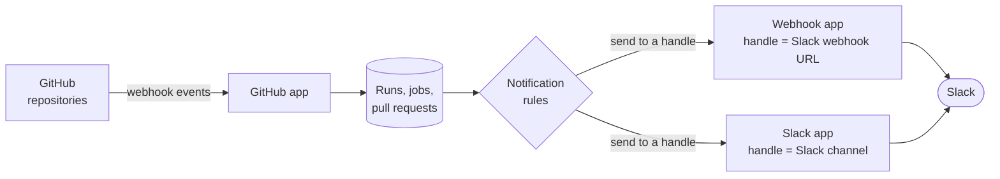

# Apps Overview

An **app** is a piece of GitGazer you install into an integration. One app brings data in, the others send alerts out:

| App         | Direction | What it does                                                                                   | Details                                                   |
| ----------- | --------- | ---------------------------------------------------------------------------------------------- | --------------------------------------------------------- |
| **GitHub**  | In        | Receives workflow runs, jobs and pull requests from GitHub.                                    | [GitHub App Settings](integrations#github-app-settings)   |
| **Webhook** | Out       | Holds named Slack incoming webhooks that notification rules send alerts to.                    | [Webhook App Settings](integrations#webhook-app-settings) |
| **Slack**   | Out       | Sends alerts to Slack channels and mentions the person behind a failure, without webhook URLs. | [Slack App](slack-app)                                    |

## How the Apps Work Together

1. The **GitHub** app receives events from your GitHub organizations and repositories, through the GitHub App installations linked to it or a manual webhook. GitGazer stores them, and they show up in [Workflows](workflows) and [Dashboards](dashboards).
2. When a job fails, GitGazer checks the integration's [notification rules](notifications).
3. Each rule sends to a **handle**, a named destination inside an output app. A handle in the **Webhook** app is a Slack incoming webhook URL; a handle in the **Slack** app is a Slack channel.

Because rules point at handles, you set up a destination once and reuse it in many rules. Changing a handle's URL or channel changes it for every rule that uses it.

## The Apps Tab

Open an integration and select the **Apps** tab. It lists the **Installed** apps first, each as a card with a short summary, and then the apps still **Available** to install.

| App     | The card shows                                                                                    |
| ------- | ------------------------------------------------------------------------------------------------- |
| GitHub  | The number of linked GitHub App installations and the org sync role.                              |
| Webhook | The number of handles and of the rules that use them.                                             |
| Slack   | The Slack workspace (or **Disconnected**), its channels and how many members are linked to Slack. |

Click a card to open the app's settings.

## Install an App

_Requires **admin** role or higher._

An integration has at most one app of each type.

- **GitHub** — installed automatically when the integration is created. If it was removed, click **Install** in the **Available** list.
- **Webhook** — click **Install** in the **Available** list, then add handles.
- **Slack** — click **Install**; Slack asks you to pick a workspace and allow the app, then sends you back. See [Install the App](slack-app#install-the-app).

## Handles

Handles live in the Webhook and Slack apps:

- A **Webhook** handle is a name and a Slack incoming webhook URL. See [Add a Handle](integrations#add-a-handle).
- A **Slack** handle is a Slack channel. See [Add Channels](slack-app#add-channels).

Each app holds up to **20** handles, and a handle name is at most 100 characters. Deleting a handle keeps the rules that used it, but they show **No destination** and send nothing until you pick another handle.

If you have both apps, you can move Webhook handles over to Slack channels; see [Move From Webhooks](slack-app#move-from-webhooks).

## Remove an App

_Requires **admin** role or higher._

Open the app and click **Remove GitHub app**, **Remove Webhook app** or **Remove Slack app**, then confirm with **Remove app**. Removing an app does this:

| App     | What happens                                                                                                                                                                                                                                      |
| ------- | ------------------------------------------------------------------------------------------------------------------------------------------------------------------------------------------------------------------------------------------------- |
| GitHub  | Ingest stops: every GitHub App installation is unlinked, the webhooks GitGazer created are removed and the webhook secret is deleted. Collected data, org-synced members and their roles are kept. Installing the app again creates a new secret. |
| Webhook | All handles and their URLs are deleted. The rules that used them are kept but send nothing.                                                                                                                                                       |
| Slack   | All channel handles are deleted. The rules are kept but send nothing. Links between people and their Slack accounts stay while another integration uses the same Slack workspace.                                                                 |

## Who Can Do What

| Action                                                                     | Minimum role |
| -------------------------------------------------------------------------- | ------------ |
| See the installed apps, their handles (names, Slack channels) and settings | viewer       |
| See the GitHub app's webhook secret and the URLs of Webhook handles        | admin        |
| Install or remove apps, add, edit and delete handles                       | admin        |
| Link GitHub App installations, change webhook events and the org sync role | admin        |
| Connect your own Slack account                                             | viewer       |

See [Roles & Permissions](../technical/roles-and-permissions.md) for the full list.
