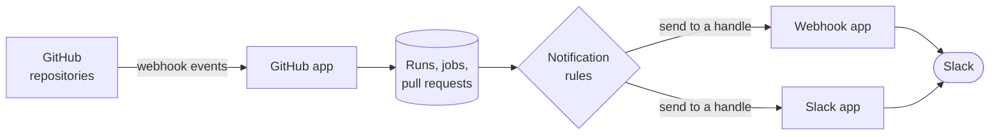

# Apps Overview

A GitGazer **app** is a building block you install into an [integration](../integrations.md). Apps connect the integration to the outside world: one app brings GitHub data in, the others send alerts out. Each integration has its own apps and their settings, so two integrations can send to different places.

All apps live on the integration's **Apps** tab.

## Available Apps

| App                     | Kind        | What it does                                                                                             |
| ----------------------- | ----------- | -------------------------------------------------------------------------------------------------------- |
| [GitHub](./github.md)   | Source      | Receives workflow runs, jobs, pull requests and reviews from GitHub. Installed in every new integration. |
| [Webhook](./webhook.md) | Destination | Holds named Slack incoming webhooks that notification rules send alerts to.                              |
| [Slack](./slack.md)     | Destination | Sends alerts to Slack channels and mentions the person behind a failure, without webhook URLs.           |

## How Apps Work Together

1. The **source** app, GitHub, receives events from your repositories. GitGazer stores them, and they show up in [Workflows](../workflows.md) and [Dashboards](../dashboards.md).
2. When a job fails, GitGazer checks the integration's [notification rules](../notifications.md).
3. Each rule sends to a **handle** in a **destination** app.

## Handles

A handle is a named destination inside a destination app: a Slack incoming webhook URL in the Webhook app, a Slack channel in the Slack app. Rules point at handles instead of holding a URL or channel themselves, so you set a destination up once and reuse it in many rules.

Each destination app holds up to 20 handles. Deleting a handle keeps the rules that used it, but they show **No destination** and send nothing until you pick another handle.

## The Apps Tab

The **Apps** tab lists the **Installed** apps first, each as a card with a short summary, and then the apps you can still install under **Available**. Click a card to open the app's settings.

An integration has at most one app of each type.

- **Install** an app with the **Install** button next to it under **Available**.
- **Remove** an app with the **Remove … app** button at the bottom of its settings. What is deleted and what is kept depends on the app; each app's page describes it.

## Permissions

Everyone in the integration can see the installed apps, their handles and their settings, except secrets: the GitHub app's webhook secret and the URLs of Webhook handles are only shown to admins and owners. Installing and removing apps and managing handles requires the **admin** role or higher. See [Roles & Permissions](../../technical/roles-and-permissions.md) for the full list.
